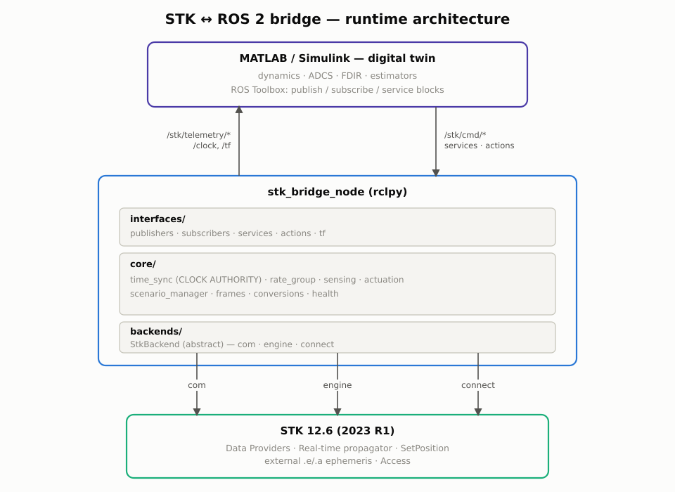

# `stk_ros2_bridge` — Architecture, Package Structure & Implementation Plan

**Target:** AGI/Ansys STK **12.6 (2023 R1)** · ROS 2 **Humble** · MATLAB **R2023b / R2024a** (ROS Toolbox)
**Approach:** A — Python `agi.stk12` Object Model + `rclpy`
**Status:** Phase 0 (design) — code generation begins at Phase 1

---

## 1. Version-driven design constraints

These are hard constraints for 12.6 and they shape every decision below.

| Constraint | Consequence |
|---|---|
| `agi.stk12` is **in-process only** (no gRPC until 12.8) | The bridge node runs on the STK host. No remote Python→STK. |
| STK Object Model is **COM / Windows-only** | Bridge process is Windows in the default deployment. |
| STK Connect (TCP :5001) is the **only** network-transparent interface | Reserved as the remote backend for a future Linux split. |
| `agi.stk12` requires **Python ≥ 3.8** | Compatible with ROS 2 Humble's Windows build (Python 3.8). ✔ |
| ROS 2 Humble on Ubuntu uses **Python 3.10** | Only relevant if the bridge later moves to Linux + STK Engine. |
| MATLAB ROS Toolbox: **Humble on R2023b–R2024a** | Pin the MATLAB release to match. Mismatched distros break custom messages. |
| `ros2genmsg` on Windows needs **MSVC** | Custom `stk_msgs` must be compiled on the MATLAB side too. See §7. |

### 1.1 The central design decision: backend abstraction

Everything STK-facing goes behind one interface, `StkBackend`. Three implementations ship:

| Backend | Transport | Host | Use |
|---|---|---|---|
| `com` | `agi.stk12.stkdesktop`, in-process COM | Windows, with GUI | **Default.** Full fidelity + 3D visualization. |
| `engine` | `agi.stk12.stkengine`, in-process, `noGraphics=True` | Windows **or Linux** | Headless / CI / batch. Needs Engine entitlement. |
| `connect` | Raw TCP to port 5001 | Any → Windows STK | Remote/cross-OS. Lower rate, text parsing. |

This is the whole migration story. Moving to a Linux ROS graph, to headless CI, or to STK 12.8's gRPC later means **adding or selecting a backend**, not restructuring the node. Nothing above `backends/` may import `agi.stk12` or touch COM types.

---

## 2. Deployment topologies

**T1 — Single-host Windows (recommended for Phase 1–5).**
STK 12.6 Desktop, `stk_bridge` node, ROS 2 Humble (Windows binaries), and MATLAB/Simulink all on one machine. Zero network boundary, lowest latency, simplest to debug. DDS over loopback.

**T2 — Split, bridge stays with STK.**
Windows: STK + `stk_bridge` (COM backend) + ROS 2 Humble. Linux: MATLAB/Simulink + rest of ROS graph. DDS over LAN with a shared `ROS_DOMAIN_ID`. Requires firewall rules for RTPS discovery (UDP 7400–7500 range).

**T3 — Split, bridge on Linux.**
Windows: STK only. Linux: `stk_bridge` with `connect` backend + everything else. Fully Linux ROS graph, at the cost of Connect's text round-trips.

**T4 — All-Linux (license permitting).**
STK Engine headless on Ubuntu, `engine` backend, in-process with `rclpy`. Cleanest, but no GUI and requires an Engine-on-Linux entitlement.

Selected via `backend.type` + `backend.connect.host` in `bridge_params.yaml`. No code change.

---

## 3. Runtime architecture



Hand-authored (`docs/figures/bridge_architecture.svg`), not generated by
an auto-layout tool — see `docs/C6_analysis.md` section 3 for why that
matters for every figure in this project, not only the C6 ones. The
same topology in plain text, for a terminal or a diff:

```
                          ┌─────────────────────────────────────────┐
                          │  MATLAB / Simulink  (digital twin)      │
                          │  dynamics · ADCS · FDIR · estimators    │
                          │  ROS Toolbox: ros2publisher/subscriber, │
                          │  Simulink Publish/Subscribe/Call Service│
                          └───────▲──────────────────────┬──────────┘
                    /stk/telemetry/*                 /stk/cmd/*
                    /clock, /tf                      services, actions
                          ┌───────┴──────────────────────▼──────────┐
                          │        stk_bridge_node  (rclpy)         │
                          │                                         │
                          │  interfaces/  publishers · subscribers  │
                          │               services · actions · tf   │
                          │  ───────────────────────────────────────│
                          │  core/  time_sync (CLOCK AUTHORITY)     │
                          │         rate_group · sensing            │
                          │         actuation · scenario_manager    │
                          │         frames · conversions · health   │
                          │  ───────────────────────────────────────│
                          │  backends/  StkBackend  (abstract)      │
                          └───────┬─────────────────────────────────┘
                     com │      engine │        connect │
                          ▼             ▼                ▼
                   ┌──────────────────────────────────────────┐
                   │            STK 12.6 (2023 R1)            │
                   │  Data Providers · Real-time propagator   │
                   │  SetPosition · external .e/.a · Access   │
                   └──────────────────────────────────────────┘
```

### 3.1 Threading model

COM apartment rules make this non-negotiable:

- **Main thread** — owns the COM apartment (STA). *All* `agi.stk12` calls happen here. `rclpy` executor callbacks that touch STK are dispatched onto it via a work queue.
- **Executor thread(s)** — `MultiThreadedExecutor` handles ROS I/O, serialization, publishing. Never touches STK objects directly.
- **Handoff** — a bounded `queue.Queue` of command objects, drained each tick. Backpressure policy configurable (`drop_oldest` / `block` / `reject`).

This is exactly the failure mode the seed's best-practice #3 warned about, and the reason the bridge is a separate process from MATLAB rather than an S-function.

### 3.2 Execution modes (`core/time_sync.py`)

| Mode | Behaviour | Use |
|---|---|---|
| `free_run` | STK animates on wall clock; bridge samples at fixed rate. `/clock` mirrors wall time. | Visualization, demos. |
| `paced` | STK stepped at a configurable real-time factor. | Human-in-the-loop review. |
| `lockstep` | **Bridge is clock authority.** Advances STK one step, samples, publishes `/clock`, waits for all command topics to report for that stamp, then steps again. | **Default for control work.** Deterministic and reproducible. |
| `external` | Another node owns `/clock`; bridge follows. | Federating with a third simulator. |

All downstream nodes (including MATLAB) run `use_sim_time:=true`. Lockstep barrier participants are declared in config so the bridge knows whom to wait for and can time out cleanly.

### 3.3 Multi-rate sensing (`core/rate_group.py`)

Not every quantity needs 10 Hz. Data providers are grouped:

- **fast** (default 10 Hz) — Cartesian Position/Velocity, Attitude Quaternion, angular velocity
- **medium** (1 Hz) — LLA, eclipse/lighting, sensor boresight, beta angle
- **slow** (0.1 Hz) — access status, link budget (C/N₀, Eb/N₀, margin)
- **on_demand** — coverage, long-horizon access, arbitrary DP queries via service

Groups are declared in `sensing_pipeline.yaml`, so adding a telemetry channel is a config edit, not a code change. Bulk extraction uses `IAgDrDataSetCollection.ToNumpyArray()` (available from 12.6) on the COM/engine backends.

### 3.4 Actuation paths (`core/actuation.py`)

| ROS input | STK mechanism | Notes |
|---|---|---|
| `/stk/cmd/position` | Real-time propagator + `SetPosition` | Append-only; points become historical. Configure look-ahead/behind. |
| `/stk/cmd/attitude` | External attitude (`.a`) file, chunked rewrite + reload | 12.6 has no per-sample attitude injection; we buffer and rewrite. |
| `/stk/cmd/ephemeris` | `StkExternal` propagator, `.e` / CCSDS `.oem` | Batch replay of a Simulink-propagated trajectory. |
| `ExecuteManeuver` action | Astrogator segment mutation + `RunMCS` | Requires Astrogator license. |
| `ExecuteConnect` service | Raw Connect passthrough | Deliberate escape hatch for anything unmodelled. |

The attitude path is the one real wart in 12.6 and gets its own buffering strategy (write-behind with configurable flush interval) documented in Phase 4.

### 3.5 Frames and units (`core/frames.py`, `core/conversions.py`)

The highest-risk area for silent, plausible-looking bugs. Explicit rules:

- **Units.** STK reports km, km/s. ROS is REP-103 SI: metres, m/s. Conversion happens once, at the backend boundary. Nothing above `backends/` sees kilometres.
- **Quaternions.** STK's Object Model quaternion element order is **(q1, q2, q3, q4) = (x, y, z, w)** — same ordering convention as ROS `geometry_msgs/Quaternion`, but this is verified per-data-provider at startup by a self-test rather than assumed, because STK's *Connect* text output and some DP variants differ. Never trust an unvalidated quaternion.
- **Frames.** ICRF / J2000 / Fixed (ECEF) / LVLH / Body are published as an explicit `frame_id` string on every message, plus a `tf2` tree rooted at `icrf`. REP-105 names (`map`, `odom`, `base_link`) are *not* forced onto orbital frames — a `frames.yaml` alias table maps them if a downstream consumer expects them.
- **Time.** STK epochs (UTCG / EpSec) ↔ ROS `builtin_interfaces/Time`. Leap seconds handled via the configured epoch and STK's own time conversion, not by hand.

A startup self-test cross-checks one state vector through both a Data Provider and a Connect `Report` to catch convention drift before the loop ever runs.

---

## 4. Package structure

```
stk_ros2_ws/
├── README.md
├── docs/
│   ├── 00_architecture.md
│   ├── 01_installation_windows.md
│   ├── 02_matlab_setup.md
│   ├── 03_message_reference.md
│   ├── 04_frames_and_units.md
│   ├── 05_time_synchronization.md
│   ├── 06_troubleshooting.md
│   └── 07_extending_backends.md
└── src/
    ├── stk_msgs/                        # ament_cmake — interfaces only
    │   ├── CMakeLists.txt
    │   ├── package.xml
    │   ├── msg/
    │   │   ├── OrbitState.msg
    │   │   ├── AttitudeState.msg
    │   │   ├── AngularRate.msg
    │   │   ├── LLAState.msg
    │   │   ├── SatelliteState.msg
    │   │   ├── EclipseState.msg
    │   │   ├── SensorPointing.msg
    │   │   ├── SensorFieldOfView.msg
    │   │   ├── AccessInterval.msg
    │   │   ├── AccessIntervalArray.msg
    │   │   ├── AccessStatus.msg
    │   │   ├── LinkBudget.msg
    │   │   ├── LinkBudgetArray.msg
    │   │   ├── GroundStationAER.msg
    │   │   ├── EphemerisPoint.msg
    │   │   ├── EphemerisSegment.msg
    │   │   ├── AttitudeCommand.msg
    │   │   ├── PositionCommand.msg
    │   │   ├── ManeuverCommand.msg
    │   │   ├── ImpulsiveBurn.msg
    │   │   ├── FiniteBurn.msg
    │   │   ├── ScenarioTime.msg
    │   │   ├── BridgeStatus.msg
    │   │   ├── BackendDiagnostics.msg
    │   │   ├── DataProviderRequest.msg
    │   │   ├── DataProviderResult.msg
    │   │   └── ObjectDescriptor.msg
    │   ├── srv/
    │   │   ├── LoadScenario.srv
    │   │   ├── SaveScenario.srv
    │   │   ├── ResetScenario.srv
    │   │   ├── CreateObject.srv
    │   │   ├── DeleteObject.srv
    │   │   ├── SetPropagator.srv
    │   │   ├── QueryDataProvider.srv
    │   │   ├── ComputeAccess.srv
    │   │   ├── GetLinkBudget.srv
    │   │   ├── SetAnimationTime.srv
    │   │   ├── StepSimulation.srv
    │   │   ├── SetExecutionMode.srv
    │   │   └── ExecuteConnect.srv
    │   └── action/
    │       ├── RunScenario.action
    │       ├── ExecuteManeuver.action
    │       └── ComputeCoverage.action
    │
    ├── stk_bridge/                      # ament_python — the bridge
    │   ├── package.xml
    │   ├── setup.py
    │   ├── setup.cfg
    │   ├── resource/stk_bridge
    │   ├── stk_bridge/
    │   │   ├── __init__.py
    │   │   ├── exceptions.py
    │   │   ├── backends/
    │   │   │   ├── __init__.py
    │   │   │   ├── base.py              # StkBackend ABC + dataclasses
    │   │   │   ├── com_backend.py       # agi.stk12 STKDesktop
    │   │   │   ├── engine_backend.py    # agi.stk12 STKEngine headless
    │   │   │   ├── connect_backend.py   # raw TCP :5001
    │   │   │   ├── connect_protocol.py  # ACK/NACK, framing, parsers
    │   │   │   ├── mock_backend.py      # analytic Kepler, for CI
    │   │   │   └── factory.py
    │   │   ├── core/
    │   │   │   ├── __init__.py
    │   │   │   ├── frames.py
    │   │   │   ├── conversions.py
    │   │   │   ├── data_providers.py
    │   │   │   ├── sensing.py
    │   │   │   ├── actuation.py
    │   │   │   ├── attitude_writer.py   # .a file buffering/flush
    │   │   │   ├── ephemeris_writer.py  # .e / .oem writer
    │   │   │   ├── scenario_manager.py
    │   │   │   ├── time_sync.py
    │   │   │   ├── rate_group.py
    │   │   │   ├── com_thread.py        # STA work queue
    │   │   │   ├── health.py
    │   │   │   └── validation.py        # startup self-tests
    │   │   ├── interfaces/
    │   │   │   ├── __init__.py
    │   │   │   ├── qos.py
    │   │   │   ├── ros_publishers.py
    │   │   │   ├── ros_subscribers.py
    │   │   │   ├── ros_services.py
    │   │   │   ├── ros_actions.py
    │   │   │   └── tf_broadcaster.py
    │   │   └── nodes/
    │   │       ├── __init__.py
    │   │       ├── bridge_node.py       # main entry point
    │   │       ├── clock_node.py        # standalone /clock authority
    │   │       └── diagnostics_node.py
    │   ├── config/
    │   │   ├── bridge_params.yaml
    │   │   ├── sensing_pipeline.yaml
    │   │   ├── frames.yaml
    │   │   ├── qos_profiles.yaml
    │   │   └── scenario_defaults.yaml
    │   ├── launch/
    │   │   ├── stk_bridge.launch.py
    │   │   ├── stk_bridge_mock.launch.py
    │   │   ├── stk_bridge_connect.launch.py
    │   │   └── full_twin.launch.py
    │   ├── scripts/
    │   │   ├── check_environment.py
    │   │   ├── validate_conventions.py
    │   │   └── benchmark_rates.py
    │   └── test/
    │       ├── test_conversions.py
    │       ├── test_frames.py
    │       ├── test_connect_protocol.py
    │       ├── test_rate_group.py
    │       ├── test_time_sync.py
    │       ├── test_sensing.py
    │       ├── test_actuation.py
    │       ├── test_mock_backend.py
    │       ├── test_integration_mock.py
    │       ├── test_flake8.py
    │       └── test_pep257.py
    │
    └── stk_matlab/                      # not a ROS package — MATLAB side
        ├── setup_stk_ros.m
        ├── +stkros/
        │   ├── BridgeClient.m
        │   ├── TelemetrySubscriber.m
        │   ├── CommandPublisher.m
        │   ├── ScenarioService.m
        │   └── frames.m
        ├── simulink/
        │   ├── stk_twin_template.slx        # generated by script
        │   ├── build_twin_template.m
        │   └── stk_bus_definitions.m
        └── examples/
            ├── example_01_read_telemetry.m
            ├── example_02_closed_loop_attitude.m
            └── example_03_lockstep_stepping.m
```

---

## 5. Line-of-code estimate

Counts are non-blank, non-comment source lines, with comments/docstrings adding roughly 30% on top.

| Component | Files | Est. LOC |
|---|---:|---:|
| `stk_msgs` — msg/srv/action + build files | 45 | 750 |
| `backends/` (base, com, engine, connect, protocol, mock, factory) | 8 | 2,150 |
| `core/` (frames, conversions, DP, sensing, actuation, writers, scenario, time, rate, COM thread, health, validation) | 14 | 3,600 |
| `interfaces/` (pub, sub, srv, action, tf, qos) | 7 | 1,750 |
| `nodes/` (bridge, clock, diagnostics) | 4 | 1,000 |
| `config/` YAML | 5 | 450 |
| `launch/` | 4 | 300 |
| `scripts/` (env check, convention validator, benchmark) | 3 | 450 |
| `test/` | 11 | 1,400 |
| Package plumbing (`setup.py`, `package.xml`, `setup.cfg`, resource) | 6 | 200 |
| MATLAB `+stkros` + Simulink builder + examples | 11 | 900 |
| `docs/` | 8 | 1,100 |
| **Total** | **~126** | **~14,050** |

Core runtime Python alone (backends + core + interfaces + nodes) is **~8,500 LOC** — that's the part that must be correct; the rest is declarative, generated, or documentation.

---

## 6. Phased generation plan

Six phases, each sized to complete cleanly in one response with room for explanation. Each phase ends at a state where the tree is coherent, even if not yet runnable end-to-end.

| Phase | Contents | Est. LOC | Runnable at end? |
|---|---|---:|---|
| **1** | Workspace scaffolding, `stk_msgs` complete (all msg/srv/action + CMakeLists + package.xml), `stk_bridge` package plumbing, `exceptions.py` | ~1,100 | `colcon build` succeeds; messages introspectable via `ros2 interface show` |
| **2** | `backends/` — `base.py`, `connect_protocol.py`, `connect_backend.py`, `com_backend.py`, `engine_backend.py`, `mock_backend.py`, `factory.py` | ~2,200 | Backends importable & unit-testable standalone; `mock` works with no STK |
| **3** | `core/` part 1 — `conversions.py`, `frames.py`, `data_providers.py`, `rate_group.py`, `com_thread.py`, `validation.py` | ~2,000 | Conversion/frame tests pass; convention self-test script runs |
| **4** | `core/` part 2 — `time_sync.py`, `sensing.py`, `actuation.py`, `attitude_writer.py`, `ephemeris_writer.py`, `scenario_manager.py`, `health.py` | ~2,300 | Full sense/actuate pipeline exercisable against `mock` backend |
| **5** | `interfaces/` + `nodes/` — QoS, publishers, subscribers, services, actions, tf, `bridge_node.py`, `clock_node.py`, `diagnostics_node.py` | ~2,700 | **Bridge node runs.** Telemetry flows, commands accepted, `/clock` published |
| **6** | `config/`, `launch/`, `scripts/`, `test/`, MATLAB `+stkros` + Simulink template builder + examples, `docs/` | ~3,700 | End-to-end closed loop with MATLAB/Simulink; docs complete |

**Dependency order is strict.** Phase 5 needs Phase 4's `SensingPipeline` and `TimeSync` interfaces; Phase 4 needs Phase 3's converters; Phase 3 needs Phase 2's `StkBackend` ABC; everything needs Phase 1's messages. Don't reorder.

**Contract discipline.** At each phase boundary, the public signatures consumed by later phases get frozen and restated at the top of the response, so a later phase generated in a fresh context has an authoritative interface list to code against.

**Suggested checkpoint after Phase 2:** run `scripts/check_environment.py` against your actual STK 12.6 install before investing in Phases 3–6. It verifies the `agi.stk12` wheel version in `bin\AgPythonAPI`, Python version, COM registration, licensed capabilities (Integration, Real-time propagator, Astrogator), and Connect port reachability. Cheap insurance.

---

## 7. Known gotchas to design around

1. **`ros2genmsg` on Windows requires MSVC.** MATLAB must compile `stk_msgs` itself. Install Visual Studio Build Tools and point MATLAB at the same `stk_msgs` folder. Phase 6's `setup_stk_ros.m` automates this, but the compiler must exist.
2. **MATLAB release ↔ ROS 2 distro is strict.** R2023b/R2024a → Humble. A mismatch produces custom-message failures that look like network problems.
3. **`SetPosition` is append-only.** It cannot revise already-propagated ephemeris. If Simulink needs to *replace* a trajectory, that's the `StkExternal` path, not the real-time path.
4. **Real-time-propagator vehicles are ignored by STK Coverage analysis.** If coverage is a requirement, plan a second object or the external-ephemeris path.
5. **STK licensing.** Connect *and* the Object Model both come from the **Integration** capability. Real-time propagator, Astrogator, and DSim are separately licensed. Verify before Phase 4.
6. **DDS discovery across the Win/Linux boundary (T2/T3)** needs matching `ROS_DOMAIN_ID` and open UDP multicast; Windows Firewall blocks it silently by default.
7. **Rate expectations.** Budget 1–20 Hz for a closed loop over COM, lower over Connect. Phase 6's `benchmark_rates.py` measures *your* scenario — do not design a 50 Hz controller before running it.

